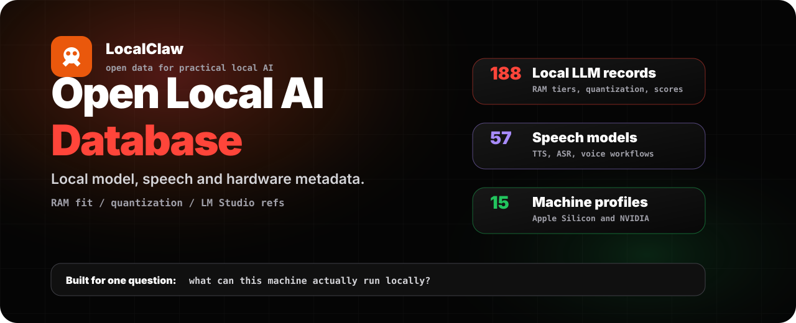
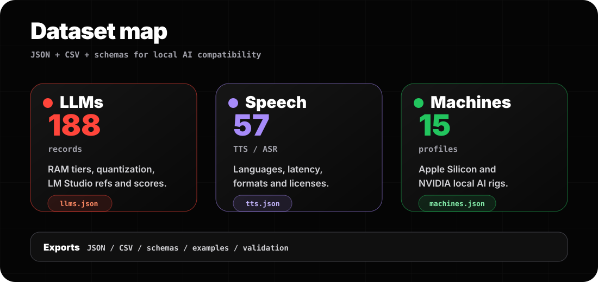
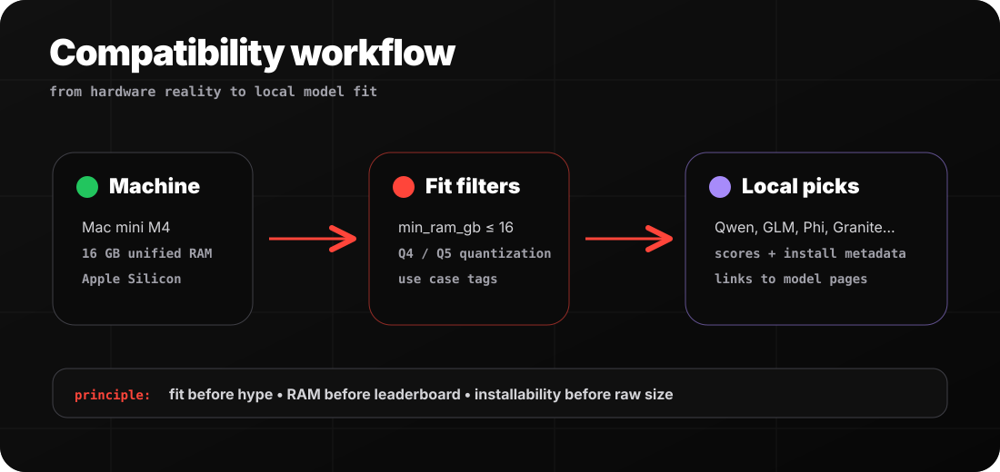

# Open Local AI Database



An open, practical database of local AI models, speech models and hardware compatibility metadata.

Published by **Cyril Dieumegard** and [LocalClaw](https://localclaw.io/).

**Snapshot date: June 19, 2026.** This release contains historical metadata. It is not the current LocalClaw catalogue, and model availability, licences and hardware estimates must be checked before present-day use. Hosted-model references are included and are not local installation records.

## Current tools and references

- [Local LLM memory calculator](https://localclaw.io/local-llm-memory-calculator): estimate weight memory, context KV cache, runtime buffers and system headroom. Share a calculation with all its inputs or export it as CSV. The formula and original architecture sources are visible; results are planning estimates, not measured benchmarks.
- [LocalClaw resource hub](https://localclaw.io/resources): tools, references and the distinction between this historical CC BY 4.0 release and newer datasets.
- [Current model compatibility guide](https://localclaw.io/#local-ai-index): use the maintained model pages and original sources for current choices.

This repository is designed for builders who need a clean answer to one deceptively hard question:

> What can this machine actually run locally?

## What is inside



| Dataset | JSON | CSV | Records |
| --- | --- | --- | ---: |
| Local LLMs | [`data/llms.json`](data/llms.json) | [`data/llms.csv`](data/llms.csv) | 191 |
| TTS / ASR / speech models | [`data/tts.json`](data/tts.json) | [`data/tts.csv`](data/tts.csv) | 58 |
| Local AI machines | [`data/machines.json`](data/machines.json) | [`data/machines.csv`](data/machines.csv) | 15 |
| Full bundle | [`data/local-ai-database.json`](data/local-ai-database.json) | - | 264 |

The data focuses on practical local usage:

- RAM fit and memory tiers
- recommended quantization
- LM Studio search terms
- Hugging Face model references when available
- coding, reasoning, quality and speed scores
- TTS / ASR language and feature metadata
- Apple Silicon and NVIDIA GB10-class machine metadata
- LocalClaw page URLs for deeper human-readable guidance

## Compatibility workflow



The database is built for practical local fit: start with a machine, filter by realistic memory headroom, then choose installable models and speech tools that match the workload.

## Why this exists

Local AI is moving fast, but most model lists are not practical enough for real users.

People do not only ask:

- "What is the best model?"

They ask:

- "Can my 16 GB Mac run this?"
- "Which model should I use in LM Studio?"
- "What quantization should I start with?"
- "What local TTS model supports voice cloning?"
- "Is this laptop enough or do I need a workstation?"

This database is built around those decisions.

## Quick start

Use the generated JSON directly:

```bash
curl -fsSL https://raw.githubusercontent.com/CyrilDieumegard/open-local-ai-database/main/data/llms.json
```

Or clone and validate locally:

```bash
git clone https://github.com/CyrilDieumegard/open-local-ai-database.git
cd open-local-ai-database
npm run validate
```

## Example queries

Find strong local LLMs for a 16 GB machine:

```js
const models = require('./data/llms.json');

const picks = models
  .filter(model => model.type === 'local_llm')
  .filter(model => model.min_ram_gb <= 16)
  .sort((a, b) => b.scores.quality - a.scores.quality)
  .slice(0, 10);

console.table(picks.map(model => ({
  name: model.name,
  ram: model.min_ram_gb,
  quant: model.recommended_quantization,
  quality: model.scores.quality
})));
```

Find LocalClaw speech picks for voice workflows:

```python
import json

with open("data/tts.json") as f:
    models = json.load(f)

picks = [
    m for m in models
    if m["is_localclaw_pick"] and "voice-cloning" in m["features"]
]

for model in picks[:10]:
    print(model["name"], model["license"], model["localclaw"]["page_url"])
```

More examples:

- [`examples/js/top-16gb-llms.js`](examples/js/top-16gb-llms.js)
- [`examples/python/find_voice_models.py`](examples/python/find_voice_models.py)

## Data format

Schemas live in [`schemas/`](schemas/):

- [`schemas/llm.schema.json`](schemas/llm.schema.json)
- [`schemas/speech.schema.json`](schemas/speech.schema.json)
- [`schemas/machine.schema.json`](schemas/machine.schema.json)

Field documentation:

- [`docs/DATA_DICTIONARY.md`](docs/DATA_DICTIONARY.md)
- [`docs/METHODOLOGY.md`](docs/METHODOLOGY.md)

## Source and update policy

This historical release was generated from the curated LocalClaw metadata used on [localclaw.io](https://localclaw.io/).

The goal is not to pretend that one benchmark decides everything. The goal is to expose practical metadata that helps people choose local models responsibly:

- fit before hype
- RAM before leaderboard score
- installability before raw model size
- local privacy before unnecessary cloud dependency

## Contributing

Contributions are welcome, especially:

- missing open local LLMs
- missing local TTS / ASR models
- metadata corrections
- hardware compatibility notes
- source links for licenses, releases and install commands
- better examples and integrations

Start here: [`CONTRIBUTING.md`](CONTRIBUTING.md)

## Attribution

If you use this dataset in a project, article, benchmark, app or video, please credit:

> Open Local AI Database by LocalClaw — https://localclaw.io/

Citation metadata is available in [`CITATION.cff`](CITATION.cff).

## License

The data published in this repository is released under [Creative Commons Attribution 4.0](LICENSE). This licence does not extend to later LocalClaw website datasets, compatibility analyses, or third-party model weights and software. See the [current dataset scope](https://localclaw.io/resources#dataset).

Scripts and examples are released under the MIT license in [`CODE_LICENSE`](CODE_LICENSE).

## Links

- Website: [localclaw.io](https://localclaw.io/)
- LLM explorer: [localclaw.io/llm-list.html](https://localclaw.io/llm-list)
- TTS explorer: [localclaw.io/tts-list.html](https://localclaw.io/tts-list)
- Computers for local AI: [localclaw.io/computers.html](https://localclaw.io/computers)
